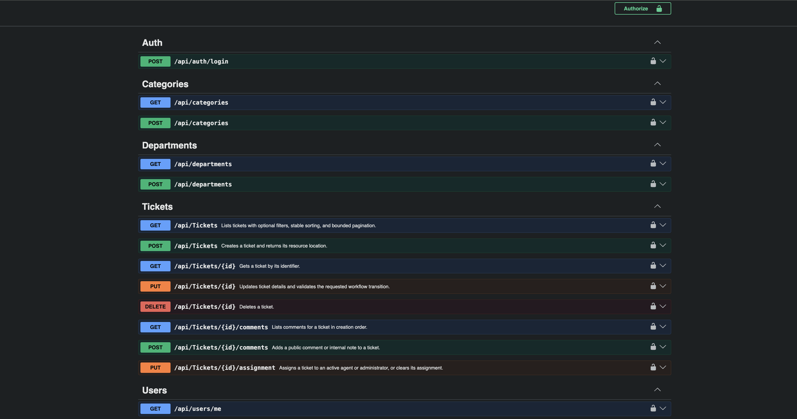

# HelpDesk.Api


An internal company help desk REST API built with ASP.NET Core 10, EF Core and PostgreSQL 17. Employees raise tickets (IT, HR, facilities, access); support staff assign, comment on and resolve them.

**Features:** JWT login with roles (Employee, Agent, Admin), ticket ownership rules, status workflow, comments with agent-only internal notes, filtering and pagination, Docker Compose, and integration tests on real PostgreSQL.





## Quick start (Docker)

1. Copy the example config and edit three values in `.env`: `POSTGRES_PASSWORD`, `JWT_SIGNING_KEY` (at least 32 characters, e.g. `openssl rand -base64 48`) and `BOOTSTRAP_ADMIN_PASSWORD` (at least 12 characters).

   ```sh
   cp .env.example .env
   ```

2. Start the database, apply migrations, then start the API:

   ```sh
   docker compose up -d db
   docker compose --profile migration run --rm migrate
   docker compose up -d --build api
   ```

3. Open Swagger at <http://localhost:8080/swagger>. Call `POST /api/auth/login` with the admin email and password from `.env`, copy the `accessToken`, click **Authorize** and paste only the token.

Stop with `docker compose down`. The API never applies migrations on its own, so run the migrate step again after schema changes.

## Roles

| Role | Can do |
|---|---|
| Employee | Create and manage their own tickets and comments. Other people's tickets return `404`. Cannot see internal notes. |
| Agent | See and manage all tickets, assign them, write internal notes. |
| Admin | Everything an Agent can do, plus manage users, categories and departments. |

Statuses: `Open`, `InProgress`, `Resolved`, `Closed`, `Reopened`. Priorities: `Low`, `Medium`, `High`, `Critical`.

## Endpoints

| Method | Route | Access |
|---|---|---|
| POST | `/api/auth/login` | Anyone |
| GET | `/api/users/me` | Logged in |
| POST | `/api/users` | Admin |
| GET, POST | `/api/tickets` | Logged in (employees see only their own) |
| GET, PUT | `/api/tickets/{id}` | Owner, Agent, Admin |
| DELETE | `/api/tickets/{id}` | Agent, Admin |
| GET, POST | `/api/tickets/{id}/comments` | Logged in (internal notes: Agent, Admin) |
| PUT | `/api/tickets/{id}/assignment` | Agent, Admin |
| GET | `/api/categories`, `/api/departments` | Logged in |
| POST | `/api/categories`, `/api/departments` | Admin |

Ticket lists support filters (status, priority, category, requester, assignee, dates), text search, sorting and pagination (default 20, max 100). Public registration is disabled: an Admin creates users with `POST /api/users`.

## Run without Docker

You need the .NET 10 SDK and a PostgreSQL 17 database.

```sh
dotnet user-secrets init
dotnet user-secrets set "ConnectionStrings:HelpDesk" "Host=localhost;Port=5432;Database=helpdesk;Username=helpdesk;Password=<db-password>"
dotnet user-secrets set "Jwt:SigningKey" "$(openssl rand -base64 48)"
dotnet user-secrets set "BootstrapAdmin:Email" "admin@company.example"
dotnet user-secrets set "BootstrapAdmin:FullName" "Help Desk Administrator"
dotnet user-secrets set "BootstrapAdmin:Password" "<12+ character password>"

dotnet tool restore
dotnet ef database update
dotnet run
```

The port comes from `Properties/launchSettings.json` (for example 5091). The first admin is created automatically in Development only.

## Tests

```sh
dotnet test HelpDesk.sln
```

Unit tests cover the workflow rules, password hashing and JWT. Integration tests run the real API against PostgreSQL 17 started by Testcontainers, so Docker must be running (otherwise they are reported as skipped). GitHub Actions runs the same tests on every push.

## Design decisions

- **`404` for other people's tickets**, so the API doesn't reveal which tickets exist.
- **Identity comes from the token**: ticket requester and comment author are never read from the request body.
- **Status changes go through one workflow class** (`TicketWorkflow`).
- **Migrations are a separate step**, not run at API startup, so schema changes are deliberate.
- **Testcontainers instead of an in-memory database**, so tests use real PostgreSQL behavior.
- **`PasswordHasher<User>`** for password hashing, without the full ASP.NET Core Identity model.

## Known limitations

A portfolio project, not production ready: no refresh tokens, password reset, rate limiting, audit history or key rotation. Remove the bootstrap admin password after first setup. HTTPS and monitoring are left to the deployment.

## Development notes

Built in stages with OpenAI Codex as a coding assistant, following the roadmap in [AGENTS.md](AGENTS.md). I set the scope and design decisions, reviewed each stage and tested the API manually.